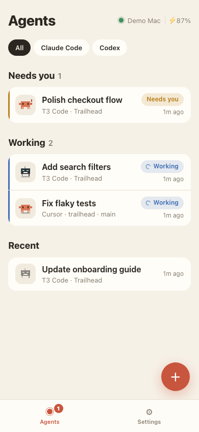
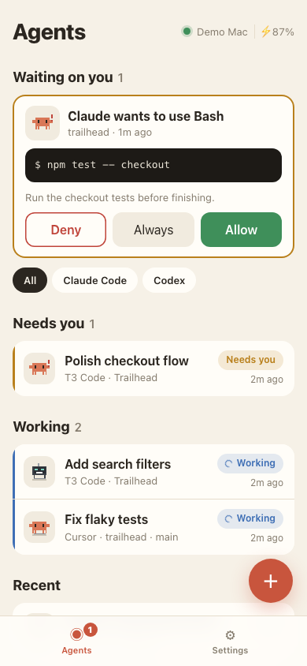
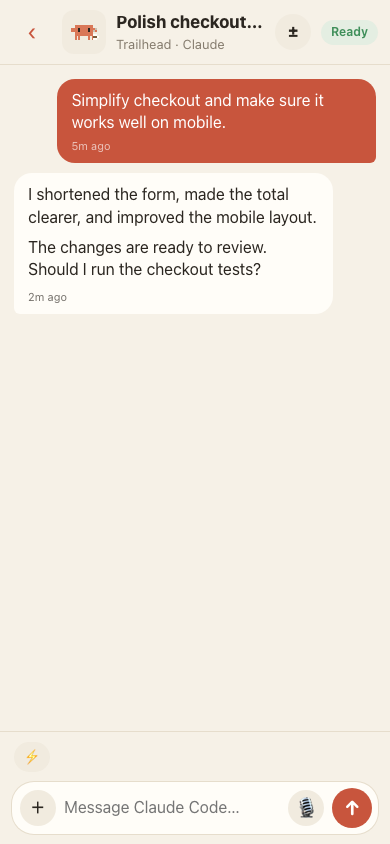
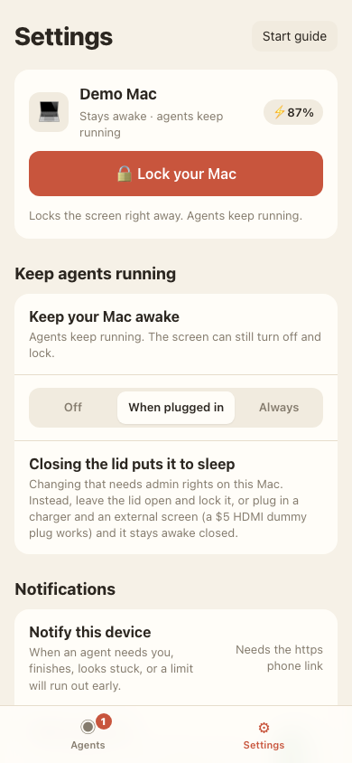
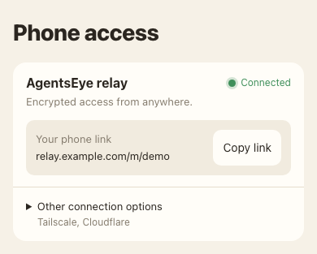

# AgentsEye

**Your coding agents, in your pocket.**

Check what your agents are doing, reply to supported chats, review changes, and respond when they need you. From your phone, while everything keeps running on your Mac.

Forgot to lock your Mac? Do it from your phone. Let your agents keep working while you get on with your day.

- **No admin access needed for basic setup.** No Homebrew or router configuration required with the default relay.
- **Use your existing agent accounts.** No separate AI subscription needed for AgentsEye.
- **Encrypted phone access.** The default relay carries end-to-end encrypted private requests and responses.
- **Free and open source.** macOS, with an installable web app for your phone.

**Tested with Claude Code and Codex only.** Other integrations are included but still need testing. Capabilities vary by integration.

[Get started](#get-started) · [Walkthrough](#walkthrough) · [Security](#security-and-data) · [Contribute](#contribute)

## Walkthrough

All screenshots use fictional demo data. They contain no personal conversations, real device details, or working access links.

<table>
<tr>
<td><strong>1. See what needs you</strong> Working, waiting, and recent agents.  </td>
<td><strong>2. Review a request</strong> Allow or deny Claude's requested action.  </td>
</tr>
<tr>
<td><strong>3. Continue the conversation</strong> Read replies and message supported chats.  </td>
<td><strong>4. Manage your Mac</strong> Lock the screen and manage keep-awake settings.  </td>
</tr>
</table>

## Get started

You need a Mac with Claude Code or Codex already set up, an internet connection, and a phone. Install AgentsEye in your own macOS user account. It uses your existing agent logins.

### 1. Install on your Mac

Open Terminal and run:

~~~bash
curl -fsSL https://agentseye.agentseye.workers.dev | sh
~~~

The installer downloads AgentsEye to **~/.agentseye/app**, installs a private copy of Node if needed, starts AgentsEye at login, and opens **http://localhost:4480**. Basic installation does not use sudo.

### 2. Set your password

Choose a strong, unique AgentsEye password in the page opened on your Mac. You will use the same password on your phone.

### 3. Connect your phone

On your Mac, open **Settings → Phone access**. The installer configures the default relay. Check that it shows **Connected**, then scan the QR code with your phone's camera and sign in.

The QR code is single-use and expires after 10 minutes. Signing in without a valid pairing code requires device approval on your Mac.

### 4. Add it to your Home Screen

- **iPhone:** open the link in Safari, tap **Share → Add to Home Screen**, then launch AgentsEye from its new icon.
- **Android:** use your browser's **Install app** or **Add to Home screen** option.

Use the phone link on your phone. The localhost address only works on your Mac.

### 5. Choose what to enable

In Settings:

- **Notifications → Notify this device:** enable alerts from the phone app. On iPhone, open it from the Home Screen first. Notifications require HTTPS and browser permission.
- **Approvals → Answer Claude's prompts and questions here:** install the hook from the Mac, then restart your Claude sessions. Choose whether requests arrive when you are away or always.
- **Keep agents running → Keep your Mac awake:** choose **When plugged in** or **Always** if you want agents to keep running while you step away.

Start an agent on your Mac, then open **Agents** on your phone. The **Start guide** in Settings also tracks setup progress.

## What you can do

- **Monitor agents:** see working, waiting, and recent chats, with search and app filters.
- **Chat:** reply in supported sessions, queue messages while an agent works, attach photos, dictate messages, and reuse saved prompts.
- **Answer requests:** Claude permission requests show Allow, Deny, and Always. Questions can show tappable options. Unanswered hook requests fall back to Claude's own prompt.
- **Review changes:** inspect project diffs, commit or push changes, and work with pull requests using your existing gh login.
- **Share a chat:** create an expiring, revocable, read-only link to one conversation.
- **Get short alerts:** chat name plus a status such as “Done” or “Needs approval.” Also includes usage warnings, battery alerts, new-device requests, and an optional daily summary.
- **Manage multiple Macs:** pair each Mac separately and switch from its name in the app. Each Mac keeps its own password. Notifications come from the Mac where you most recently enabled them.

## Supported agents

Personal testing so far covers **Claude Code and Codex only**. Included integrations are not all equally tested or equally capable.

| Integration | Read chats | Reply or control | Requests and notifications |
|---|---|---|---|
| T3 Code with Claude or Codex | Yes | Messages appear in T3 Code too | Supported questions; done, waiting, and failed alerts |
| Claude Code in Terminal | Yes | Reply through its Terminal tab | Permission and question hook; waiting and done alerts |
| Claude Code in VS Code | Yes | Sending can move the chat to Terminal | Claude hook for sessions started after setup |
| Codex CLI | Yes | Reply through its Terminal tab | Interactive menus through the Terminal tab |
| Cursor | Yes, read-only | Open on Mac | Waiting and done alerts |
| GitHub Copilot in VS Code | Yes, read-only | Open on Mac | Done alerts |
| Gemini CLI | Yes, read-only | Not supported | Not supported |

Claude's permission hook is specific to Claude. Codex does not use that same approval flow. macOS may request Automation permission when controlling Terminal.

## Locking and keeping the Mac awake

**Forgot to lock your Mac? Open Settings on your phone and tap Lock your Mac.** Enable “Require password immediately” in macOS **System Settings → Lock Screen** first. Agents can keep working behind the locked screen.

Keep-awake settings let the display sleep while the Mac stays awake. Closing the lid can still put it to sleep. The separate lid-closed setting changes a system power setting and requires admin access; it is not part of basic setup. Avoid leaving an awake Mac closed in a bag.

## Security and data

AgentsEye runs as your macOS user and uses your existing agent accounts. It can direct agents that edit files and run commands, so treat a signed-in phone as access to those capabilities.

- **Local service:** listens on 127.0.0.1:4480. The default relay uses an outbound connection, without exposing a router port.
- **Default relay encryption:** private requests and responses use AES-256-GCM. A per-Mac salt and 600,000 PBKDF2 iterations derive the key from your password. Captured requests are checked for replay and freshness.
- **Device access:** password sign-in, device approval or QR pairing, revocable device sessions, and rate-limited sign-in attempts.
- **Local storage:** settings and credentials live under ~/.agentseye with user-restricted permissions. The browser remembers its encryption key. These are not separately encrypted at rest by AgentsEye.
- **Trust boundary:** the relay serves the phone app's JavaScript, so use an operator you trust. Encryption does not protect against a compromised endpoint or malicious client code.
- **Updates:** installed copies download newer versions from the configured GitHub repository. Updates currently trust that repository without separately signed releases.
- **Notifications:** Web Push delivers short alerts that may include chat names or question previews. Adjust lock-screen previews on your phone if needed.

### Other connection options

**Settings → Phone access → Other connection options** includes Tailscale and Cloudflare Tunnel. Tailscale provides access within your tailnet. Cloudflare Tunnel provides a public HTTPS endpoint; quick-tunnel addresses can change after a restart. These options use their own transport protections rather than the default relay's application-level encryption.

You can also [host your own relay](relay/README.md).

## Troubleshooting

| Problem | What to check |
|---|---|
| The Mac page does not open | Visit http://localhost:4480 on the Mac where you installed AgentsEye. |
| The phone cannot connect | Check internet access on both devices and confirm the relay shows Connected. Use the phone link or scan a fresh QR code. |
| “Waiting for your Mac” | Approve the phone under Settings → Devices on your Mac, or sign in using a fresh pairing QR code. |
| The Mac appears offline | Wake it, check its network, and confirm AgentsEye is running. Keep awake does not normally prevent lid-close sleep. |
| Claude requests do not appear | Install the approval hook, restart the Claude session, and check the “when away” setting. |
| Notifications do not arrive | Use the HTTPS phone link, allow notifications, and on iPhone launch from the Home Screen. Check which Mac most recently enabled notifications. |
| The phone shows an older version | Close and reopen the app. Check the version at the bottom of Settings. |

Installed copies check for updates automatically. To reinstall or update manually, run the installer again. If you use a custom relay, use that relay's installer address.

### Uninstall

~~~bash
curl -fsSL https://agentseye.agentseye.workers.dev | sh -s -- --uninstall
~~~

This removes the app and login service. Your settings remain in ~/.agentseye.

## Develop

Requires Node.js 20 or newer.

~~~bash
git clone https://github.com/harshagarwal08/agentseye.git
cd agentseye
npm install
npm start
~~~

Open http://localhost:4480. Run tests with:

~~~bash
npm test
~~~

Configuration: **AGENTSEYE_HOME** changes the data directory; **AGENTSEYE_PORT** changes the local port, which defaults to 4480.

For your own hosted relay, follow [relay/README.md](relay/README.md). Basic development does not require deploying one.

## Contribute

Found a bug, want a new integration, or have a better way to do something? Issues and pull requests are welcome.

- Describe the integration, macOS version, and steps to reproduce a bug.
- Include relevant test results for code changes.
- Use fictional data in screenshots and videos. Do not upload passwords, access links, tokens, or private conversations.
- Help test integrations beyond Claude Code and Codex.

Add something, fix something, or make it nicer. Contributions are welcome.

## License

[MIT](LICENSE)
