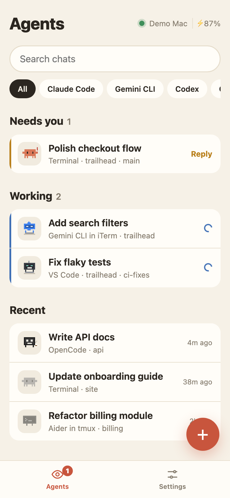
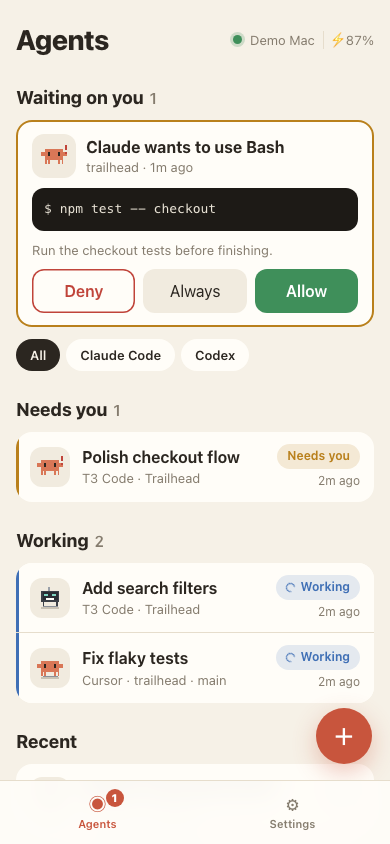
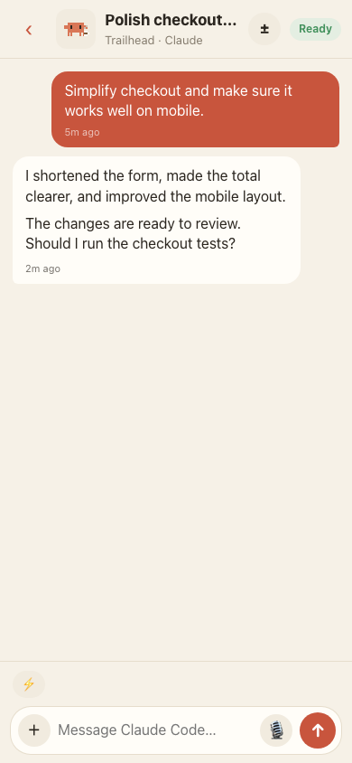
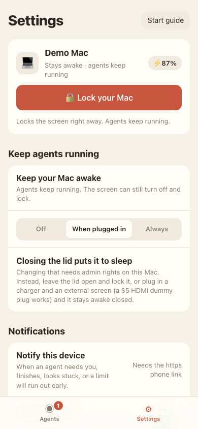
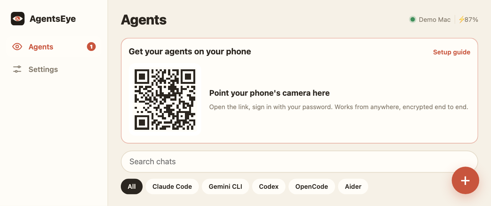

# AgentsEye

**Every coding agent on your Mac, in your pocket.**

Claude Code, Codex, Gemini CLI, OpenCode, Cursor, Copilot, Aider, Amp, Qwen Code and more. See what they're doing, answer when they need you, type into their terminal, approve requests, review changes. From your phone, while everything keeps running on your Mac.

Forgot to lock your Mac? Do it from your phone. Let your agents keep working while you get on with your day.

- **No admin access needed.** No Homebrew, no router setup.
- **Use your existing agent accounts.** No separate AI subscription needed for AgentsEye.
- **Your own private relay.** One tap puts a relay on your own free Cloudflare account. Nothing is shared with anyone else, and everything through it is end-to-end encrypted. Or use Tailscale, Cloudflare Tunnel, or your own server.
- **Free and open source.** macOS, with an installable web app for your phone.

**Most tested with Claude Code and Codex.** The other integrations are newer. Please [report](https://github.com/harshagarwal08/agentseye/issues) anything that doesn't work with your agent.

[How it works](#how-it-works) · [Get started](#get-started) · [Walkthrough](#walkthrough) · [Security](#security-and-data) · [Contribute](#contribute)

## How it works

**The short version:** your AI coding helpers keep working on your Mac. AgentsEye lets you check on them, and talk to them, from your phone.

Think of it like a baby monitor for your coding agents.

1. **A small app runs quietly on your Mac.** It watches your coding agents (Claude Code, Codex, Gemini and others): what they're working on, whether they're done, and whether they're stuck waiting for you.
2. **Your phone connects to it through your own secure "mailbox" on the internet** (we call it the relay). It runs on your own free Cloudflare account, so it's yours alone. Your Mac and your phone both talk to the mailbox, so your phone can reach your Mac from anywhere: home, office, or a coffee shop. You don't need to set up your Wi-Fi or router.
3. **Everything is locked before it leaves your Mac.** Messages are scrambled with a key made from your password, and only your Mac and your phone know that password. The mailbox passes the locked messages along but cannot read them.
4. **When an agent needs you, your phone buzzes.** Tap it, see what the agent is asking, and answer. The agent carries on, and you never had to walk back to your desk.

~~~
   Your Mac                    The relay ("mailbox")                Your phone
 ┌───────────────┐   locked   ┌──────────────────────┐   locked   ┌──────────────┐
 │ Claude, Codex │ ─────────▶ │  passes messages on, │ ─────────▶ │  AgentsEye   │
 │ Gemini, ...   │ ◀───────── │  can't read them     │ ◀───────── │  app         │
 └───────────────┘            └──────────────────────┘            └──────────────┘
~~~

**What stays private:** your code, your chats and your files stay on your Mac. AgentsEye has no account system, no tracking and no analytics. It doesn't use any AI of its own; it only talks to the agents you already use.

**Who can get in:** only devices that know your password *and* that you've approved (or that scanned the QR code on your Mac). You can sign any device out from Settings at any time.

## Walkthrough

All screenshots use fictional demo data. They contain no personal conversations, real device details, or working access links.

<table>
<tr>
<td><strong>1. See what needs you</strong> Working, waiting, and recent agents.  </td>
<td><strong>2. Review a request</strong> Allow or deny Claude's requested action.  </td>
</tr>
<tr>
<td><strong>3. Continue the conversation</strong> Read replies and message supported chats.  </td>
<td><strong>4. Manage your Mac</strong> Lock the screen and manage keep-awake settings.  </td>
</tr>
</table>

## Get started

You need a Mac with Claude Code or Codex already set up, an internet connection, and a phone. Install AgentsEye in your own macOS user account. It uses your existing agent logins.

### 1. Install on your Mac

Open Terminal and run:

~~~bash
curl -fsSL https://raw.githubusercontent.com/harshagarwal08/agentseye/master/install.sh | sh
~~~

The installer downloads AgentsEye to **~/.agentseye/app**, installs a private copy of Node if needed, starts AgentsEye at login, and opens **http://localhost:4480**. Basic installation does not use sudo.

### 2. Set your password

Choose a strong, unique AgentsEye password in the page opened on your Mac (http://localhost:4480). You will use the same password on your phone.

### 3. Connect your phone

Tap **Connect my phone**. A Terminal window opens and asks you to sign in to Cloudflare in the browser (a free account is enough; sign up there if you don't have one). It puts your private relay on *your* account in about a minute. Then a QR code appears on the Mac page: scan it with your phone's camera and sign in with your password.

Same thing from Terminal: `agentseye relay deploy`. Rather not use Cloudflare? See [other connection options](#connection-options).

The QR code is single-use and expires after 10 minutes. Signing in without a valid pairing code requires device approval on your Mac.

### 4. Add it to your Home Screen

- **iPhone:** open the link in Safari, tap **Share → Add to Home Screen**, then launch AgentsEye from its new icon.
- **Android:** use your browser's **Install app** or **Add to Home screen** option.

Use the phone link on your phone. The localhost address only works on your Mac.

### 5. Choose what to enable

In Settings:

- **Notifications → Notify this device:** enable alerts from the phone app. On iPhone, open it from the Home Screen first. Notifications require HTTPS and browser permission.
- **Approvals → Answer Claude's prompts and questions here:** install the hook from the Mac, then restart your Claude sessions. Choose whether requests arrive when you are away or always.
- **Keep agents running → Keep your Mac awake:** choose **When plugged in** or **Always** if you want agents to keep running while you step away.

Start an agent on your Mac, then open **Agents** on your phone. The **Start guide** (linked from the home screen and Settings) ticks these off as you go.

## What you can do

- **Monitor agents:** see working, waiting, and recent chats, with search and app filters.
- **Chat:** reply in supported sessions, queue messages while an agent works, attach photos, dictate messages, and reuse saved prompts.
- **Answer requests:** Claude permission requests show Allow, Deny, and Always. Questions can show tappable options. Unanswered hook requests fall back to Claude's own prompt.
- **Review changes:** inspect project diffs, commit or push changes, and work with pull requests using your existing gh login.
- **Share a chat:** create an expiring, revocable, read-only link to one conversation.
- **Get short alerts:** chat name plus a status such as “Done” or “Needs approval.” Also includes usage warnings, battery alerts, new-device requests, and an optional daily summary.
- **Manage multiple Macs:** pair each Mac separately and switch from its name in the app. Each Mac keeps its own password. Notifications come from the Mac where you most recently enabled them.

## Supported agents

AgentsEye finds agents two ways: by reading their chat logs, and by finding their process and the terminal it runs in. Any agent in **Terminal.app, iTerm2, or tmux** (in any terminal app, including VS Code's and Cursor's built-in terminals, Ghostty, Warp, kitty…) can be watched live and typed into from your phone.

| Agent | See it | Reply / control from phone | Alerts |
|---|---|---|---|
| Claude Code (Terminal, iTerm, tmux) | Chat + live terminal | Yes | Permission prompts and questions via hook; waiting, done, stuck |
| Claude Code in VS Code / Cursor extension | Chat | Sending moves the chat to Terminal | Hook for sessions started after setup |
| Codex CLI | Chat + live terminal | Yes, including its menus | Done, waiting |
| T3 Code (Claude or Codex) | Chat | Yes, appears in T3 Code too | Questions; done, waiting, failed |
| Gemini CLI | Chat + live terminal | Yes, in a terminal it can reach | Needs you, done |
| OpenCode | Chat + live terminal | Yes, in a terminal it can reach | Needs you, done |
| Cursor CLI, Copilot CLI, Qwen Code, Amp, Aider, Goose, Crush, Droid, Kiro CLI, Auggie, Kimi CLI | Live terminal | Yes, in a terminal it can reach | Needs you, done (read from the screen) |
| Cursor (editor chat) | Chat | Read only, open on Mac | Waiting, done |
| GitHub Copilot in VS Code | Chat | Read only, open on Mac | Done |

**Start any of them from your phone:** the **+** button lists every agent CLI installed on your Mac and opens it in a Terminal window in the folder you choose, with your first message.

**Running an agent somewhere AgentsEye can't type into** (Ghostty, Warp, the VS Code terminal)? Run it inside tmux. `agentseye wrap` does that for you:

~~~bash
agentseye wrap gemini        # any agent: wrap opencode, wrap aider, wrap claude…
~~~

`agentseye doctor` shows which agents are installed, which are running, and whether each one can be controlled.

Claude's permission hook is specific to Claude. macOS asks once for Automation permission the first time AgentsEye controls Terminal or iTerm.

## Locking and keeping the Mac awake

**Forgot to lock your Mac? Open Settings on your phone and tap Lock your Mac.** Enable “Require password immediately” in macOS **System Settings → Lock Screen** first. Agents can keep working behind the locked screen.

Keep-awake settings let the display sleep while the Mac stays awake. Closing the lid can still put it to sleep. The separate lid-closed setting changes a system power setting and requires admin access; it is not part of basic setup. Avoid leaving an awake Mac closed in a bag.

## Security and data

AgentsEye runs as your macOS user and uses your existing agent accounts. It can direct agents that edit files and run commands, so treat a signed-in phone as access to those capabilities.

- **Local service:** listens on 127.0.0.1:4480. The relay uses an outbound connection, without exposing a router port.
- **Default relay encryption:** private requests and responses use AES-256-GCM. A per-Mac salt and 600,000 PBKDF2 iterations derive the key from your password. Captured requests are checked for replay and freshness.
- **Device access:** password sign-in, device approval or QR pairing, revocable device sessions, and rate-limited sign-in attempts.
- **Local storage:** settings and credentials live under ~/.agentseye with user-restricted permissions. The browser remembers its encryption key. These are not separately encrypted at rest by AgentsEye.
- **Trust boundary:** the relay serves the phone app's JavaScript, so use an operator you trust. Encryption does not protect against a compromised endpoint or malicious client code.
- **Updates:** installed copies download newer versions from the configured GitHub repository. Updates currently trust that repository without separately signed releases.
- **Notifications:** Web Push delivers short alerts that may include chat names or question previews. Adjust lock-screen previews on your phone if needed.

## Connection options

Pick whichever suits you in **Settings → Phone access**. You can change it any time; phones just scan the new QR code.

| Option | Setup | Good for |
|---|---|---|
| **Your own relay** (default) | **Connect my phone**, or `agentseye relay deploy`. Free Cloudflare account | Everyone. Private, end-to-end encrypted, works on company Macs behind proxies. Redeploys itself when AgentsEye updates. |
| **Tailscale** | Tailscale on Mac and phone | Private tailnet access with a stable address. |
| **Cloudflare Tunnel** | One tap, no account; installs cloudflared privately, no admin | A quick public HTTPS link. The address changes when it restarts. |
| **Your own server** | `docker build -f relay/Dockerfile .` on any VPS, or `node relay/server.js` | Teams, or anyone who'd rather not use Cloudflare. See [relay/README.md](relay/README.md). |

Behind a company proxy where Cloudflare's browser sign-in fails? Create an API token (Cloudflare dashboard → My Profile → API Tokens → "Edit Cloudflare Workers" template) and run `CLOUDFLARE_API_TOKEN=<token> agentseye relay deploy`.

Tailscale and Cloudflare Tunnel use their own transport protections rather than the relay's application-level encryption.

## Notification behavior

Claude usage and token-limit alerts are disabled; usage remains visible in the app. Agent approvals, questions, completion alerts and the optional daily summary remain available. Identical notifications are suppressed for one minute, including across Mac app restarts. Replacement notifications update quietly instead of buzzing again.

## Troubleshooting

| Problem | What to check |
|---|---|
| The Mac page does not open | Visit http://localhost:4480 on the Mac where you installed AgentsEye. |
| The phone cannot connect | Check internet access on both devices and confirm the relay shows Connected. Use the phone link or scan a fresh QR code. |
| “Waiting for your Mac” | Approve the phone under Settings → Devices on your Mac, or sign in using a fresh pairing QR code. |
| The Mac appears offline | Wake it, check its network, and confirm AgentsEye is running. Keep awake does not normally prevent lid-close sleep. |
| Claude requests do not appear | Install the approval hook, restart the Claude session, and check the “when away” setting. |
| An agent shows but can't be typed into | Run `agentseye doctor`. Start it in Terminal or iTerm, or with `agentseye wrap <agent>` in any terminal. |
| Cloudflare sign-in fails (company proxy) | Use an API token: see [Connection options](#connection-options). |
| Notifications do not arrive | Use the HTTPS phone link, allow notifications, and on iPhone launch from the Home Screen. Check which Mac most recently enabled notifications. |
| The phone shows an older version | Close and reopen the app. Check the version at the bottom of Settings. |

Installed copies check for updates automatically. To reinstall or update manually, run the installer again. If you use a custom relay, use that relay's installer address.

### Uninstall

~~~bash
curl -fsSL https://raw.githubusercontent.com/harshagarwal08/agentseye/master/install.sh | sh -s -- --uninstall
~~~

This removes the app and login service. Your settings remain in ~/.agentseye.

## Command line

~~~
agentseye doctor                which agents and connections AgentsEye can see
agentseye relay deploy          your own free relay on your Cloudflare account
agentseye relay status          which relay this Mac uses
agentseye set-relay <url>       use a relay you host
agentseye wrap <agent> [args]   run any agent CLI in tmux so your phone can drive it from any terminal app
agentseye install-hook          send Claude Code permission prompts to your phone
agentseye update                update now (also automatic)
~~~

If `agentseye` isn't on your PATH: `~/.agentseye/node/bin/node ~/.agentseye/app/bin/agentseye.js <command>` (or `node ~/.agentseye/app/bin/agentseye.js`).

## Develop

Requires Node.js 20 or newer.

~~~bash
git clone https://github.com/harshagarwal08/agentseye.git
cd agentseye
npm install
npm start
~~~

Open http://localhost:4480. Run tests with:

~~~bash
npm test
~~~

Configuration: **AGENTSEYE_HOME** changes the data directory; **AGENTSEYE_PORT** changes the local port, which defaults to 4480.

For your own hosted relay, follow [relay/README.md](relay/README.md). Basic development does not require deploying one.

## Contribute

Found a bug, want a new integration, or have a better way to do something? Issues and pull requests are welcome.

- Describe the integration, macOS version, and steps to reproduce a bug.
- Include relevant test results for code changes.
- Use fictional data in screenshots and videos. Do not upload passwords, access links, tokens, or private conversations.
- Help test integrations beyond Claude Code and Codex. Adding a terminal agent is usually one line in `server/cli-agents.js`.

Add something, fix something, or make it nicer. Contributions are welcome.

## License

[MIT](LICENSE)
